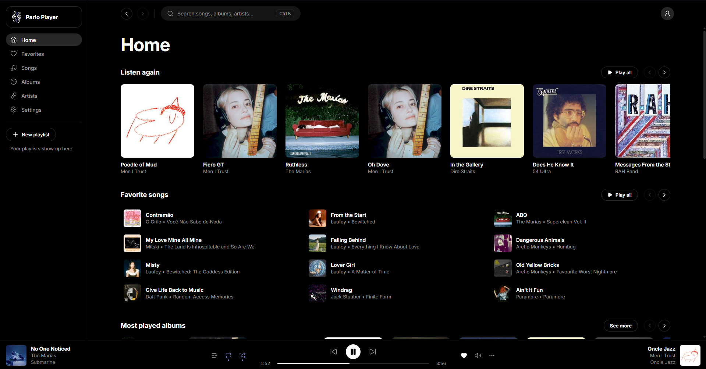
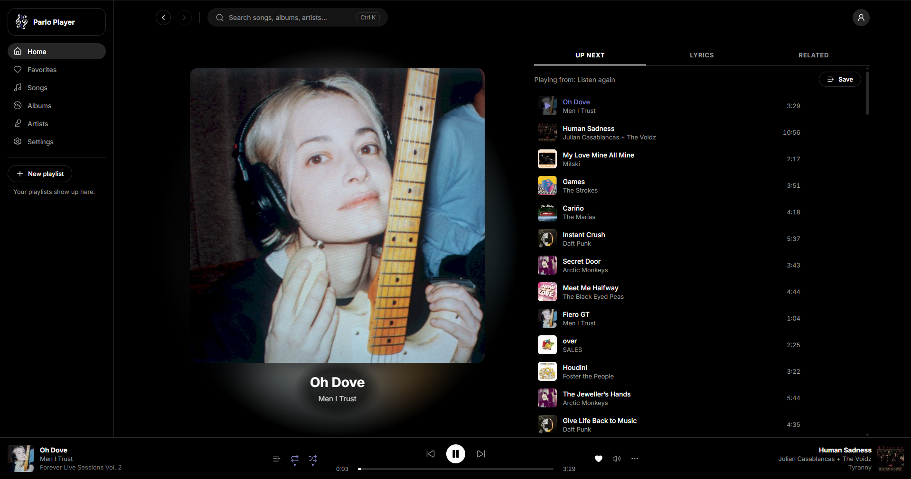
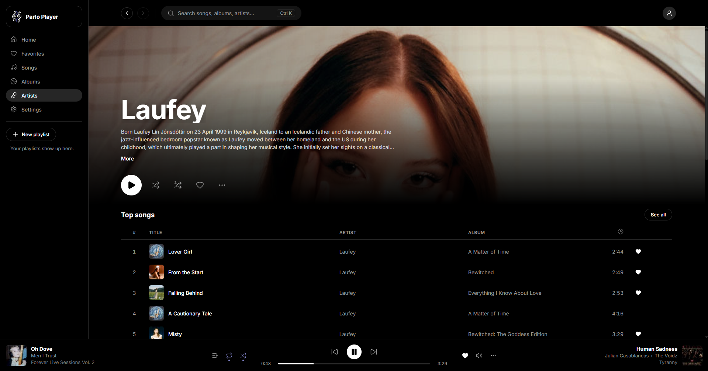
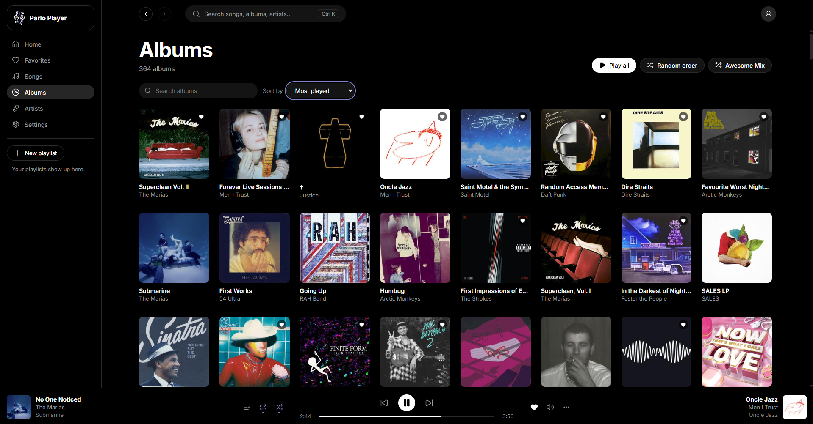
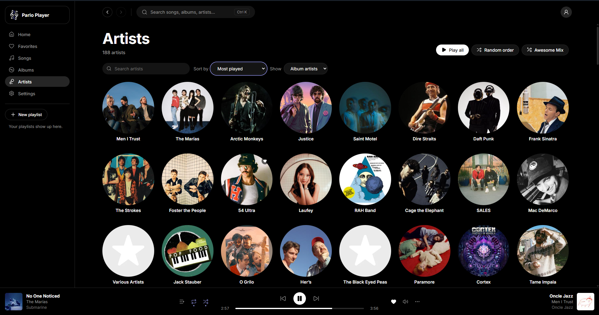
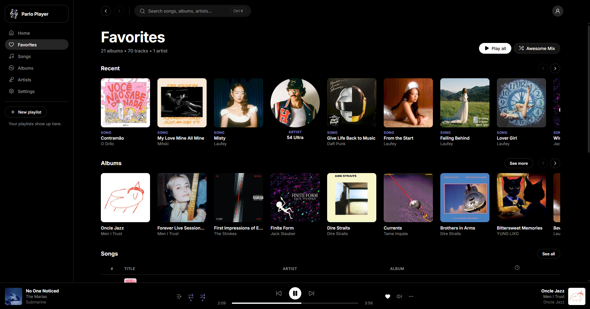
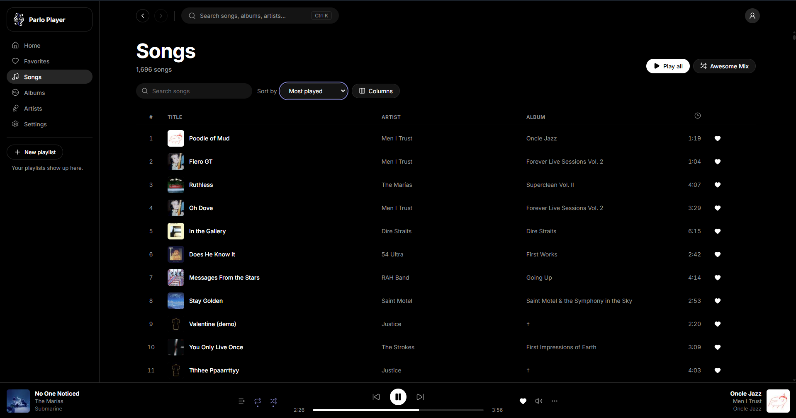

<div align="center">


# Parlo Player

**Um player de música desktop, leve e bonito, para o seu servidor Subsonic.**

Cliente para **Linux** e **Windows** de servidores compatíveis com a API Subsonic / OpenSubsonic, feito pensando no [Navidrome](https://www.navidrome.org/).

-3E4095)


[](LICENSE)

</div>

---

<!-- SCREENSHOTS:START -->
<div align="center">



</div>

<table>
  <tr>
    <td width="50%"><p align="center"><b>Tocando Agora</b></p></td>
    <td width="50%"><p align="center"><b>Página do artista</b></p></td>
  </tr>
  <tr>
    <td width="50%"><p align="center"><b>Álbuns</b></p></td>
    <td width="50%"><p align="center"><b>Artistas</b></p></td>
  </tr>
  <tr>
    <td width="50%"><p align="center"><b>Favoritos</b></p></td>
    <td width="50%"><p align="center"><b>Músicas</b></p></td>
  </tr>
</table>
<!-- SCREENSHOTS:END -->

## Sobre

O Parlo Player toca a sua biblioteca de música direto do seu servidor, com uma interface preta, limpa e arredondada inspirada no [Swing Music](https://github.com/swingmx/swingmusic), e a estrutura de navegação de apps como o YouTube Music e o Sonixd.

A ideia é simples: **o servidor é a fonte da verdade**. Favoritos, playlists, fila e reproduções são salvos no servidor, então tudo continua sincronizado com qualquer outro app Subsonic que você usa (Symfonium, Feishin, a própria interface do Navidrome etc.). No computador ficam só o cache da biblioteca, as capas, o histórico detalhado e as suas preferências.

## Recursos

- 🎧 **Áudio de verdade pelo backend:** reprodução com **libmpv** em Rust (sem a tag `<audio>` do navegador), com **gapless**, pré-carregamento da próxima faixa e **ReplayGain**. Toca FLAC, ALAC, MP3, AAC, Opus, OGG e WAV.
- ⚡ **Rápido com bibliotecas grandes:** a biblioteca é sincronizada para um cache **SQLite** local, então busca, filtros e ordenação são instantâneos, mesmo com dezenas de milhares de faixas.
- 🔍 **Busca enquanto digita** (Ctrl+K), com melhor resultado, músicas, álbuns e artistas.
- 📀 **Telas completas:** Início, Favoritos, Músicas, Álbuns, Artistas, página do artista e página de álbum/playlist.
- 🎶 **Tocando Agora:** capa grande com as abas **A Seguir**, **Letra** (sincronizada, via OpenSubsonic) e **Relacionados**.
- 🔀 **Três jeitos de tocar:** *Tocar tudo*, *Em ordem aleatória* e o **Mix Incrível**, que mistura tudo e pode ser salvo como playlist.
- ❤️ **Sincronizado com o servidor:** favoritos, playlists, fila (retomada de onde você parou) e scrobble.
- ⌨️ **Atalhos de teclado** para tocar, pausar, buscar e navegar (veja abaixo).
- 🖥️ **Integrado ao sistema** *(em breve)*: controles de mídia (MPRIS no Linux, SMTC no Windows) e ícone na bandeja para continuar tocando com a janela fechada.
- 🔒 **Seguro:** a senha fica no cofre do sistema (Gerenciador de Credenciais no Windows, Secret Service no Linux), e a autenticação usa token + salt.
- 🌐 Interface em **português** e **inglês**.

## Atalhos de teclado

| Atalho | Ação |
| --- | --- |
| `Espaço` | Tocar / pausar |
| `Ctrl` + `K` | Busca |
| `Ctrl` + `B` | Abrir / fechar o Tocando Agora |
| `Ctrl` + `→` / `Ctrl` + `←` | Próxima / anterior |
| `→` / `←` | Avançar / voltar 5 segundos |

## Instalação

> O Parlo Player ainda está em desenvolvimento e **não tem instaladores publicados**. Por enquanto, a forma de usar é compilar a partir do código (veja abaixo). Os instaladores para Windows (instalador e versão portátil) e Linux (AppImage e Flatpak) vão aparecer na página de [Releases](https://github.com/RyanBordin/Parlo-Player/releases).

Você vai precisar de um servidor compatível com Subsonic / OpenSubsonic rodando, de preferência o [Navidrome](https://www.navidrome.org/).

## Compilando a partir do código

### Pré-requisitos

- [Node.js](https://nodejs.org/) (LTS) e npm
- [Rust](https://www.rust-lang.org/tools/install) (stable)
- As [dependências do Tauri 2](https://v2.tauri.app/start/prerequisites/) para o seu sistema
- **libmpv 2.0 ou mais nova**:

| Sistema | Como instalar |
| --- | --- |
| Debian / Ubuntu | `sudo apt install libmpv-dev` |
| Fedora | `sudo dnf install mpv-devel` (RPM Fusion) |
| Arch | `sudo pacman -S mpv` |
| Windows | Baixar a DLL para `src-tauri/lib/mpv/` e gerar o `mpv.lib`. O passo a passo está em [docs/libmpv-windows.md](docs/libmpv-windows.md). |

### Rodando

```bash
git clone https://github.com/RyanBordin/Parlo-Player.git
cd Parlo-Player
npm install
npm run tauri dev
```

Para gerar o app final:

```bash
npm run tauri build
```

### Outros comandos úteis

| Comando | O que faz |
| --- | --- |
| `npm run check` | Checagem de tipos da interface (Svelte + TypeScript) |
| `cargo test --workspace` (dentro de `src-tauri/`) | Testes do backend Rust (app e `parlo-core`) |
| `cargo test -- --ignored` | Testes de integração contra um servidor real (copie `.env.example` para `.env` e preencha) |
| `npm run tauri:perf` | Abre uma biblioteca fictícia de 50 mil faixas para medir desempenho |
| `npm run licenses` | Gera a lista de licenças de terceiros |

## Tecnologias

| Camada | Tecnologia |
| --- | --- |
| App desktop | [Tauri 2](https://tauri.app/) |
| Interface | [Svelte 5](https://svelte.dev/) + TypeScript ([SvelteKit](https://svelte.dev/docs/kit) estático) |
| Backend | Rust |
| Áudio | [libmpv](https://mpv.io/) via [`libmpv2`](https://crates.io/crates/libmpv2) |
| Banco local | SQLite ([`rusqlite`](https://crates.io/crates/rusqlite)) |
| Senha | Cofre do sistema ([`keyring`](https://crates.io/crates/keyring)) |
| Traduções | [Paraglide JS](https://inlang.com/m/gerre34r/library-inlang-paraglideJs) |
| Ícones | [Lucide](https://lucide.dev/) |

<details>
<summary><b>Estrutura do projeto</b></summary>

```
Parlo-Player/
├── src/                  Interface (Svelte + TypeScript)
│   ├── routes/           Telas (Início, Álbuns, Artistas, Músicas, Favoritos, Busca...)
│   └── lib/              Componentes, estado e chamadas ao backend
├── src-tauri/            Backend (Rust, workspace Cargo)
│   ├── crates/parlo-core/  Lógica compartilhada com o app Android (sem Tauri, sem libmpv)
│   │   └── src/
│   │       ├── subsonic/ Cliente da API Subsonic (token + salt, endpoints, tipos)
│   │       ├── player/   Fila, retomada, tempo ouvido, ReplayGain
│   │       ├── db/       Cache SQLite (biblioteca, histórico, preferências)
│   │       └── settings.rs  Preferências do app
│   └── src/              App desktop
│       ├── player/       Reprodução com libmpv, gapless
│       ├── sync/         Sincronização completa e leve com o servidor
│       └── covers/       Cache de capas no disco
├── messages/             Textos da interface (pt-BR e en)
├── assets/logo/          Logo do app
└── docs/                 Especificação e guias
```

</details>

## Roadmap

**v0.1 (MVP, em andamento)**

- [x] Login, sincronização da biblioteca e cache local
- [x] App shell: barra lateral, busca no topo e Player Bar
- [x] Reprodução com fila, shuffle, repeat, gapless, retomada e scrobble
- [x] Telas de Início, Músicas, Álbuns, Artistas, página do artista, Favoritos e página de álbum/playlist
- [x] Tocando Agora (A Seguir, Letra e Relacionados) e menus `...`
- [ ] Controles de mídia do sistema (MPRIS/SMTC) e bandeja
- [ ] Instaladores para Windows e Linux

**v0.2**

- [ ] Downloads e modo offline
- [ ] Playlists automáticas (retrospectivas e playlists vivas)
- [ ] Filtros avançados por metadado
- [ ] Botões na miniatura da barra de tarefas do Windows

**Depois:** temas e cor de destaque, vários servidores, crossfade, equalizador, Discord Rich Presence e atualização automática.

A especificação completa do app está em [docs/Parlo-Player_especification.md](docs/Parlo-Player_especification.md).

## Inspirações

O Parlo Player junta o que mais gosto em outros players: o visual do [Swing Music](https://github.com/swingmx/swingmusic), a estrutura do YouTube Music Desktop, o layout de álbum e a Player Bar do [Sonixd](https://github.com/jeffvli/sonixd), a usabilidade do [Symfonium](https://symfonium.app/) e a densidade de listas do [Feishin](https://github.com/jeffvli/feishin) e do [Supersonic](https://github.com/dweymouth/supersonic).

## Licença

O código do Parlo Player é distribuído sob a licença [MIT](LICENSE).

A libmpv e as demais bibliotecas de terceiros têm as suas próprias licenças. A lista completa aparece no app em **Configurações → Sobre → Licenças de terceiros**.
